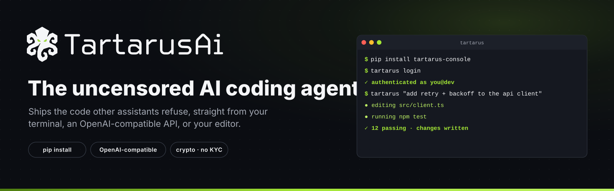
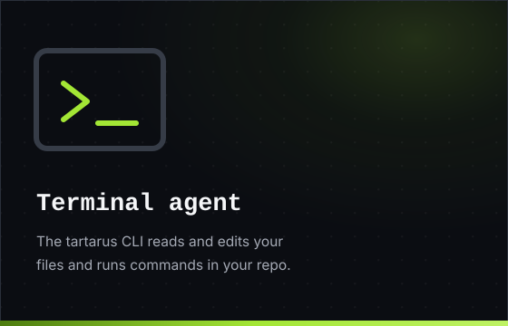
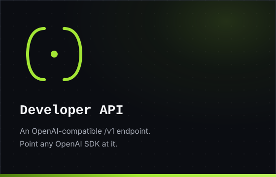
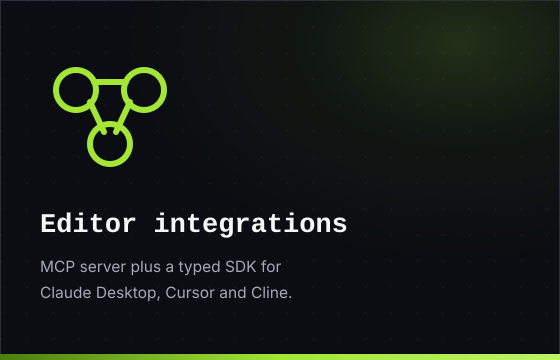
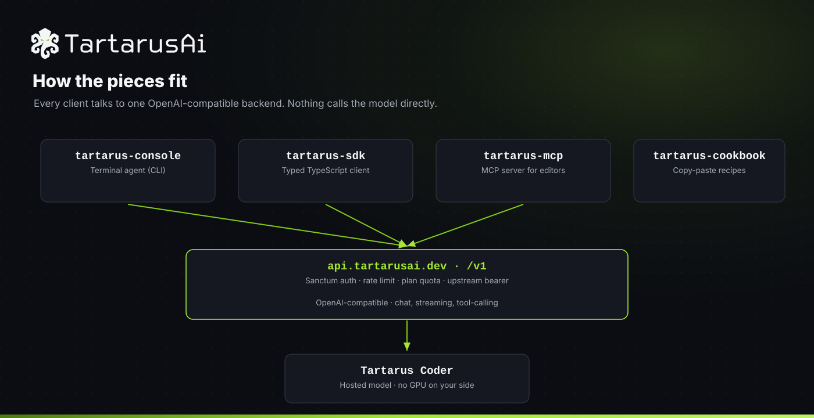

<!-- Tartarus AI — organization profile. Assets generated by brand/make-assets.py -->

<a href="https://tartarusai.dev/?utm_source=github&utm_medium=readme&utm_campaign=org-profile&utm_content=hero">
  
</a>

<p align="center">
  <a href="https://tartarusai.dev/?utm_source=github&utm_medium=readme&utm_campaign=org-profile&utm_content=cta-website"></a>
  <a href="#quickstart"></a>
  <a href="https://dash.tartarusai.dev/?utm_source=github&utm_medium=readme&utm_campaign=org-profile&utm_content=cta-dashboard"></a>
</p>

<p align="center">
  <b><a href="#quickstart">Quickstart</a></b> ·
  <a href="https://github.com/TartarusAIDev/tartarus-console">CLI</a> ·
  <a href="https://github.com/TartarusAIDev/tartarus-sdk">TypeScript SDK</a> ·
  <a href="https://github.com/TartarusAIDev/tartarus-mcp">MCP</a> ·
  <a href="https://github.com/TartarusAIDev/tartarus-cookbook">API examples</a> ·
  <a href="https://github.com/TartarusAIDev/refusal-bench">Benchmark</a>
</p>

---

Tartarus is an AI coding agent that **ships code instead of refusals**. It runs
in your terminal, reads and edits your files, runs commands, and calls tools to
finish the task. Under the hood it talks to a hosted model over an
**OpenAI-compatible API**, so there is nothing to run locally and no GPU
required. Billing is crypto-only, with no KYC.

## What you can build

<table>
<tr>
<td width="33%" valign="top">
<br>
<b>Terminal agent</b><br>
Use the <code>tartarus</code> CLI inside an existing project. It edits files and
runs commands, with your approval, until the task is done.
</td>
<td width="33%" valign="top">
<br>
<b>Developer API</b><br>
Call the hosted model from your own code through an OpenAI-compatible
<code>/v1</code> endpoint. Point any OpenAI SDK at it and keep your tooling.
</td>
<td width="33%" valign="top">
<br>
<b>Editor integrations</b><br>
Drop the model into Claude Desktop, Cursor or Cline with the MCP server, or wire
it into an app with the typed TypeScript SDK.
</td>
</tr>
</table>

## Quickstart

**Terminal (CLI)**

```bash
pip install tartarus-console
tartarus login
tartarus "add unit tests for this module"
```

The CLI stores your dashboard token in `~/.tartarus/cli-token.json`. Generate one
at **[dash.tartarusai.dev](https://dash.tartarusai.dev/?utm_source=github&utm_medium=readme&utm_campaign=org-profile&utm_content=quickstart) → Account → CLI access → Generate**.

**API (any OpenAI client)**

```bash
curl https://api.tartarusai.dev/v1/chat/completions \
  -H "Authorization: Bearer $TARTARUS_TOKEN" \
  -H "Content-Type: application/json" \
  -d '{
    "model": "tartarus-coder",
    "messages": [{"role": "user", "content": "write a port scanner in Go"}]
  }'
```

Prefer a typed client? [`tartarus-sdk`](https://github.com/TartarusAIDev/tartarus-sdk)
(TypeScript) and the [`tartarus-cookbook`](https://github.com/TartarusAIDev/tartarus-cookbook)
(Python / Node / curl) have copy-paste examples.

## How the pieces fit



Every client talks to the same backend. Nothing calls the model directly, so
authentication, rate limiting and plan quota apply to every request.

## Repositories

### Build with Tartarus

| Repo | What it is |
|---|---|
| [**tartarus-console**](https://github.com/TartarusAIDev/tartarus-console) | The `tartarus` CLI — an uncensored coding agent in your terminal |
| [**tartarus-sdk**](https://github.com/TartarusAIDev/tartarus-sdk) | Typed TypeScript client: chat, streaming, tool-calling |
| [**tartarus-mcp**](https://github.com/TartarusAIDev/tartarus-mcp) | MCP server: the model as a tool in Claude Desktop, Cursor, Cline |
| [**tartarus-cookbook**](https://github.com/TartarusAIDev/tartarus-cookbook) | Runnable recipes for the API: Python, Node, curl |

### Research and learning

| Repo | What it is |
|---|---|
| [**refusal-bench**](https://github.com/TartarusAIDev/refusal-bench) | Measure a model's false-refusal rate on legitimate coding tasks |
| [**uncensored-ai-guide**](https://github.com/TartarusAIDev/uncensored-ai-guide) | Vendor-neutral guide: abliteration, local vs hosted, tool-calling |
| [**awesome-uncensored-ai**](https://github.com/TartarusAIDev/awesome-uncensored-ai) | Curated list of uncensored and locally-runnable AI tooling |

## The developer path

```
Discover  →  Install  →  Configure  →  Build  →  Test  →  Integrate
 profile      pip         login         CLI /      run      SDK + MCP
 + repos      install     (token)       API        it       in your tools
```

1. **Discover** — browse the repos above or the [website](https://tartarusai.dev/?utm_source=github&utm_medium=readme&utm_campaign=org-profile&utm_content=path-discover).
2. **Install** — `pip install tartarus-console`, or add the SDK to a TS project.
3. **Configure** — generate a token in the [dashboard](https://dash.tartarusai.dev/?utm_source=github&utm_medium=readme&utm_campaign=org-profile&utm_content=path-configure) and `tartarus login`.
4. **Build** — run the CLI in your repo, or call `/v1/chat/completions` from code.
5. **Test** — iterate; the agent runs your commands and reads the results.
6. **Integrate** — wire the SDK into an app, or add the MCP server to your editor.

## Trust and support

- **Source** — the SDK, MCP server, cookbook, benchmark and guides in this org
  are open source. The CLI is distributed on PyPI as
  [`tartarus-console`](https://pypi.org/project/tartarus-console/); its repo here
  holds the documentation and issue tracker.
- **Licensing** — code is MIT; the curated list is CC0; the guide is CC BY 4.0.
  See each repo's `LICENSE`.
- **Compatibility** — the API follows the OpenAI Chat Completions shape
  (`/v1/chat/completions`, `/v1/models`), including streaming and `tool_calls`.
- **Support** — open an issue on the relevant repo, or use the links on the
  [website](https://tartarusai.dev/?utm_source=github&utm_medium=readme&utm_campaign=org-profile&utm_content=support). Security reports: see each repo's `SECURITY.md`.

<div align="center">
<sub>
<b><a href="https://tartarusai.dev/?utm_source=github&utm_medium=readme&utm_campaign=org-profile&utm_content=footer-site">tartarusai.dev</a></b>
·
<a href="https://dash.tartarusai.dev/?utm_source=github&utm_medium=readme&utm_campaign=org-profile&utm_content=footer-dashboard">Dashboard</a>
·
<a href="https://github.com/TartarusAIDev">GitHub</a>
</sub>
</div>
